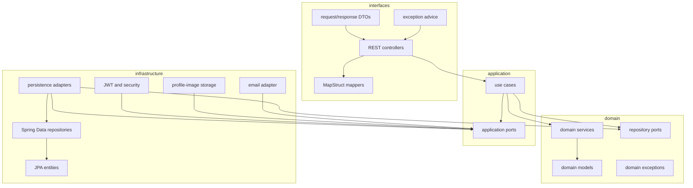
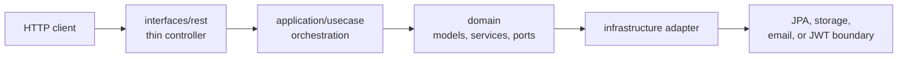
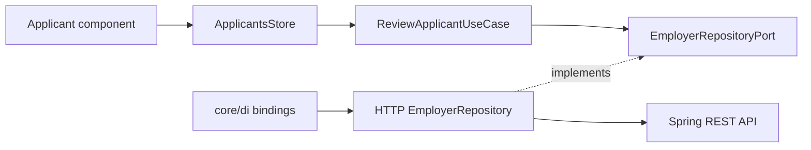

# JobsDB Clone

A full-stack JobsDB-style job marketplace with separate workflows for job seekers, employers, and administrators. The repository is a single monorepo with a Spring Boot API, an Angular web app, shared contract notes, and Docker Compose orchestration for local PostgreSQL, pgAdmin, backend, frontend, and uploaded profile images.

## Repository Map

```text
Fullstack-job-seeker-clone/
|-- backend/                 Spring Boot 4 REST API
|   |-- src/main/java/...     Clean Architecture application code
|   |-- src/main/resources/   application.yml and Flyway migrations
|   |-- src/test/java/...     backend unit and slice tests
|   `-- pom.xml              Maven build
|-- frontend/                Angular 21 web app
|   |-- src/app/             routes, features, data repositories, domain models
|   |-- e2e/                 Playwright workflows and responsive matrix
|   |-- public/              static public assets
|   |-- nginx.conf           production reverse proxy and SPA routing
|   `-- package.json         npm scripts and dependencies
|-- contracts/               API notes, examples, and future generated clients
|-- docker-compose.yml       production-like local stack
|-- docker-compose.dev.yml   hot-reload development overrides
|-- .env.example             safe local environment template
|-- AGENTS.md                repository guidance for coding agents
`-- README.md
```

Keep framework files inside their owning app folder. The root is reserved for orchestration, shared documentation, and repo-level configuration.

## Backend Structure

Package root: `com.darklordempeor.jobsdb`

```text
backend/src/main/java/com/darklordempeor/jobsdb/
|-- JobsdbApplication.java
|-- domain/
|   |-- model/               pure domain models and enums
|   |-- repository/          repository ports
|   |-- service/             domain services
|   `-- exception/           domain exceptions
|-- application/
|   |-- model/               commands, results, hiring projections and snapshots
|   |-- port/                focused persistence, password, token and storage contracts
|   `-- usecase/             auth, admin, employer, and job-seeker orchestration
|-- infrastructure/
|   |-- persistence/
|   |   |-- entity/          JPA entities
|   |   |-- repository/      Spring Data JPA repositories
|   |   `-- adapter/         domain repository adapters
|   |-- security/            stateless JWT, Spring Security, Swagger config
|   |-- storage/             local profile-image storage and upload resources
|   `-- email/               SMTP email adapter
`-- interfaces/
    |-- rest/                thin REST controllers
    |-- dto/                 request and response DTOs
    |-- mapper/              MapStruct mappers
    `-- advice/              global exception handling
```

Runtime resources:

```text
backend/src/main/resources/
|-- application.yml          local and docker profile configuration
`-- db/migration/
    |-- V1__init_schema.sql
    |-- V2__seed_admin.sql
    |-- V3__reset_seed_admin_password.sql
    |-- V4__profile_fields_certifications_and_seed_jobs.sql
    `-- V5__hiring_workflows.sql
```

Backend source dependencies (arrows point toward the dependency):



Backend request flow:



Controllers validate HTTP DTOs and map them to application-owned commands. Use cases return application results; response mappers perform no database access. Domain models stay Spring-free, JPA entities stay separate from domain models, and schema changes are owned by Flyway. API responses use the shared `ApiResponse<T>` envelope. The request-flow arrows above show runtime calls through ports; infrastructure implements those ports and depends inward.

This is a pragmatic Clean Architecture: backend use cases retain Spring service/transaction annotations, while domain models, application commands/results, and ports remain framework-free. See [the architecture guide](contracts/CLEAN_ARCHITECTURE.md) for concrete request flows, changed files, and automated boundary checks.

## Frontend Structure

```text
frontend/src/app/
|-- app.routes.ts            top-level lazy route configuration
|-- app.config.ts            app providers and HTTP interceptor setup
|-- core/
|   |-- di/                  repository tokens, live adapter bindings and use-case factories
|   |-- auth/                auth service, SignalStore, and role guard
|   |-- http/                functional JWT and error interceptors
|   |-- i18n/                language service
|   |-- notifications/       session-scoped inbox state and unread badge
|   `-- layout/              shell, navbar, sidebar, and footer
|-- application/use-cases/   framework-independent workflow logic
|-- data/                    HTTP repository implementations, wire DTOs and request mappers
|-- domain/                  models, transition rules and repository interfaces
|-- features/
|   |-- home/                public landing/search entry
|   |-- auth/                login and registration
|   |-- jobs/                public job list, filters, and details
|   |-- job-seeker/          profile/work history, avatars, private résumés, saved jobs/searches, applications, interviews, settings
|   |-- employer/            dashboard, hiring analytics, post/manage jobs, applicants, interview scorecards, settings
|   |-- notifications/       private inbox, unread filtering and record links
|   `-- admin/               dashboard, users, bans, application moderation
`-- shared/
    |-- pipes/               display formatting pipes
    `-- ui/                  reusable standalone UI components
```

Frontend route schematic:

```mermaid
flowchart TD
    Root["/"] --> Home["home"]
    Root --> Jobs["jobs"]
    Jobs --> JobDetail["jobs/:id"]

    Root --> Auth["auth"]
    Auth --> Login["login"]
    Auth --> RegisterSeeker["register-job-seeker"]
    Auth --> RegisterEmployer["register-employer"]

    Root --> Seeker["job-seeker<br/>ROLE_JOB_SEEKER"]
    Seeker --> SeekerProfile["profile"]
    Seeker --> SeekerApplications["my-applications"]
    Seeker --> SeekerSavedJobs["saved-jobs"]
    Seeker --> SeekerInterviews["interviews"]
    Seeker --> SeekerSettings["settings"]

    Root --> Employer["employer<br/>ROLE_EMPLOYER"]
    Employer --> EmployerDashboard["dashboard"]
    Employer --> PostJob["post-job"]
    Employer --> ManageJobs["manage-jobs"]
    Employer --> Applicants["applicants/:id"]
    Employer --> EmployerInterviews["interviews"]
    Employer --> EmployerSettings["settings"]

    Root --> Admin["admin<br/>ROLE_ADMIN"]
    Admin --> AdminDashboard["dashboard"]
    Admin --> Users["users"]
    Admin --> AdminApplications["applications"]
```



Angular code uses standalone components, lazy feature routes, NgRx SignalStore, functional HTTP interceptors, strict TypeScript, and Tailwind CSS 4. Data access belongs in `frontend/src/app/data/`; shared TypeScript shapes belong in `frontend/src/app/domain/`.

Features inject repository tokens instead of concrete HTTP classes. `app.config.ts` installs the bindings from `core/di/repository.providers.ts`. The applicant screen delegates loading and saving to `ApplicantsStore`, which calls `ReviewApplicantUseCase` for transition rules. Simple queries can use repository contracts directly without an extra forwarding use case. Contracts use RxJS observables but have no Angular imports.



`npm run check:architecture` checks frontend imports and runs automatically before tests/builds. Backend `ArchitectureTest` checks layer boundaries during `./mvnw test`. These source checks supplement behavior and integration tests.

## Features

### Public And Authentication

- Browse active jobs with pagination and keyword or location filtering.
- View public job detail pages.
- Register as a job seeker or employer.
- Log in with stateless access tokens, single-use refresh-token rotation, and logout revocation.
- Search from the home page and share job filters through URL query parameters.
- Live API failures show errors; sample data is never substituted for a failed request. Optional sample mode is disabled by default.

### Job Seeker

- Browse a paginated saved-jobs shortlist, remove saved jobs, and see closed/unavailable states.
- Edit profile details including personal information, location, summary, expected salary, resume URL, skills, work experience, education, languages, and licences or certifications.
- Upload a JPG or PNG profile image up to 5 MB. The backend crops and resizes it to a `256 x 256` PNG.
- Apply to active jobs, save/unsave jobs, and follow a paginated application history.
- Preserve the profile details submitted with each application, even after later profile edits.
- Save contact and opt-in preferences. Profile discovery and recommendation delivery are not available yet; the settings screen makes this explicit.

### Employer

- Edit company profile settings.
- Create, update, publish, close, and review owned jobs.
- Review a paginated applicant pipeline with stage filters, submitted-profile snapshots, and private notes.
- Move applicants from Submitted to Reviewing or Rejected, then from Reviewing to Hired or Rejected, with concurrency protection and status history.
- View dashboard counts derived from owned jobs and applications.

### Admin

- Review dashboard statistics.
- Page through users, ban users with an audited reason, and lift bans.
- Page through applications and delete them with a persisted audit reason.
- Close jobs.

## Technology

### Backend

- Java 21
- Maven wrapper
- Spring Boot 4.0.6 and Spring Security 7
- Stateless JWT authentication with JJWT 0.12.6
- Spring Data JPA, Hibernate, PostgreSQL 17, and Flyway
- MapStruct 1.6.3, Lombok, validation, and SpringDoc OpenAPI
- Local filesystem profile-image storage exposed under `/uploads/**`

### Frontend

- Angular 21 standalone components
- Angular Router lazy feature routes
- NgRx SignalStore
- Tailwind CSS 4
- Strict TypeScript
- Vitest/JSDOM test tooling through Angular CLI
- Nginx production image with `/api` and `/uploads` reverse proxies

## Local Setup

Requirements:

- Java 21
- Node.js 22 or another version compatible with Angular 21
- npm 11, matching the checked-in lockfile package manager
- Docker Desktop with Docker Compose

Create the root environment file:

```powershell
Copy-Item .env.example .env
```

Update placeholder secrets in `.env`, then start PostgreSQL and pgAdmin:

Use a valid email such as `admin@example.com` for `PGADMIN_EMAIL`; pgAdmin rejects reserved suffixes such as `.local`. This pgAdmin login is separate from the application's seeded `admin@jobsdb.local` account.

```powershell
docker compose up -d postgres pgadmin
```

Run the backend:

```powershell
cd backend
.\mvnw.cmd spring-boot:run
```

Run the frontend in a second terminal:

```powershell
cd frontend
npm.cmd install
npm.cmd start
```

Local URLs:

| Service | URL |
| --- | --- |
| Frontend | `http://localhost:4200` |
| Backend API | `http://localhost:8080/api` |
| Swagger UI | `http://localhost:8080/swagger-ui.html` |
| OpenAPI JSON | `http://localhost:8080/api-docs` |
| pgAdmin | `http://localhost:5050` |

The Angular development server proxies `/api` and `/uploads` to `http://localhost:8080`.

Linux equivalents: `cp .env.example .env`, `cd backend && ./mvnw spring-boot:run`, and `cd frontend && npm ci && npm start`.

## Seed Data

Flyway creates:

- Admin account: `admin@jobsdb.local` / `password`
- A local seed employer used by sample jobs
- Twenty active sample jobs for public browsing

## API Overview

| Area | Endpoints |
| --- | --- |
| Authentication | `POST /api/auth/register/job-seeker`, `POST /api/auth/register/employer`, `POST /api/auth/login`, `POST /api/auth/refresh-token` |
| Public jobs | `GET /api/jobs`, `GET /api/jobs/{id}` |
| Job seeker | `GET /api/job-seeker/profile`, `PUT /api/job-seeker/profile`, `POST /api/job-seeker/profile/image` |
| Applications | `POST /api/applications`, `GET /api/applications/my` |
| Employer profile | `GET /api/employer/profile`, `PUT /api/employer/profile` |
| Employer jobs | `POST /api/jobs`, `PUT /api/jobs/{id}`, `PATCH /api/jobs/{id}/status`, `GET /api/employer/jobs`, `GET /api/employer/jobs/{id}/applicants` |
| Admin | `GET /api/admin/stats`, `GET /api/admin/users`, `POST /api/admin/users/{id}/ban`, `DELETE /api/admin/users/{id}/ban`, `GET /api/admin/applications`, `DELETE /api/admin/applications/{id}`, `PATCH /api/admin/jobs/{id}/close` |

## Docker

See [the hiring API contract](contracts/HIRING_WORKFLOWS.md) for new endpoints, response examples, validation, auth rules, and compatibility notes. The [implementation summary](contracts/IMPLEMENTATION_SUMMARY.md) records the changes and verification evidence.

Start the complete production-like stack:

```powershell
docker compose up --build
```

Start the complete development stack with backend and frontend hot reload:

```powershell
docker compose -f docker-compose.yml -f docker-compose.dev.yml up --build
```

Docker Compose persists PostgreSQL data, pgAdmin data, and uploaded profile images in named volumes. Do not run `docker compose down -v` unless you intend to delete that local data.

For isolated production-container smoke tests, use [Production container verification](contracts/DOCKER_VERIFICATION.md). It uses a separate Compose project, `jobsdb_test`, loopback ports, and dedicated volumes to verify Nginx routing, avatar uploads, Angular deep links and persistence after recreation.

The existing local stack was upgraded from Flyway V4 to V7, then V8 for notifications, V9 for saved searches, V10 for private résumé versions and V11 for interview scorecards. Each upgrade included backup/restore and preservation checks. See [the original upgrade](contracts/LOCAL_UPGRADE.md), [the notification release](contracts/NOTIFICATIONS.md#local-deployment), [the saved-search release](contracts/SAVED_SEARCHES.md#local-deployment), [the résumé release](contracts/RESUME_VERSIONS.md#local-deployment), and [the current scorecard release](contracts/SCORECARDS.md#local-deployment) for recovery evidence.

If port `5432` is already in use, change `DB_PORT` in `.env`, for example to `5433`.

## Nginx Routing

The production frontend image builds Angular and serves generated files through Nginx. Its configuration lives in `frontend/nginx.conf`.

| Request | Nginx behavior |
| --- | --- |
| `/api/**` | Proxies to the Spring Boot container at `http://backend:8080/api/**` |
| `/uploads/**` | Proxies uploaded profile images to `http://backend:8080/uploads/**` |
| Static assets such as `.js`, `.css`, and images | Serves files directly with a 30-day immutable cache header |
| Angular routes such as `/jobs/{id}` or `/employer/dashboard` | Falls back to `index.html` so Angular Router can handle the route |

Nginx enables gzip compression and accepts request bodies up to `7m`. This matches the backend multipart request limit while the profile-image storage adapter applies the stricter 5 MB image limit.

During local `npm.cmd start` development, Angular uses `frontend/proxy.conf.json` to forward `/api` and `/uploads` to `http://localhost:8080`.
The hot-reload Docker frontend uses `frontend/proxy.docker.conf.json`, which targets `http://backend:8080` on the Compose network.

## Verification

Backend tests and measured coverage:

```powershell
cd backend
.\mvnw.cmd verify
```

Frontend production build:

```powershell
cd frontend
npm.cmd run build
```

Frontend tests:

```powershell
cd frontend
npm.cmd run test:coverage
```

Database integration tests are opt-in locally. Use an isolated `jobsdb_test` database and the environment variables documented in [Hiring workflows](contracts/HIRING_WORKFLOWS.md#verification). The GitHub Actions workflow runs the backend suite and coverage gate against PostgreSQL 17, frontend tests/build, Playwright browser tests, three Compose configuration checks, and production-container smoke tests including pgAdmin and persistence after recreation. See [Testing and coverage](contracts/TESTING.md) for commands, viewport scope, database safeguards, and report locations.

Current boundaries: submitted résumé/avatar URLs are preserved, but the linked files are not archived; legacy unpaged APIs remain available for compatibility. Access/refresh tokens retain the existing localStorage transport. See the contract for migration and session details.

### Interview scheduling

Employers can propose up to three interview slots from applicant review. Candidates accept a time or decline; both sides can cancel, and employers can reschedule with fresh candidate confirmation. Interview pages show upcoming/history views and confirmed meetings can be downloaded as calendar files. Confirmed overlaps are checked transactionally. See [Interview scheduling](contracts/INTERVIEW_SCHEDULING.md) for API contracts, timezone behavior, migration details and verification.

Employers can record completed/no-show outcomes after an interview ends and schedule subsequent rounds. Both participants can inspect prior schedules in the revision-history drawer. Frontend tests now produce measured coverage with CI thresholds. See [Interview lifecycle and coverage](contracts/INTERVIEW_LIFECYCLE_AND_COVERAGE.md) for rules, API additions and verification.

The authenticated notification bell opens a private inbox for job matches, application and interview updates. Filter unread items, mark them read and open the linked job, application or interview. Events are stored with the triggering workflow transaction; internal hiring notes stay private. See [In-app notifications](contracts/NOTIFICATIONS.md) for endpoints and verification. Email and push delivery are outside this feature.

Candidates can save keyword, location and salary criteria, view current matching jobs and pause/resume in-app job alerts. First publication delivers one alert per candidate/job even when several searches match. Existing public search contracts remain unchanged. See [Saved searches and alerts](contracts/SAVED_SEARCHES.md) for V9 schema, matching rules, API examples and verification.

Candidates can upload private PDF résumé versions and choose one for future applications. Each submission preserves that exact PDF; employers download it through ownership-checked API routes. Unused versions can be deleted, while submitted attachments are retained. Existing external résumé links remain supported. See [Private résumé versions](contracts/RESUME_VERSIONS.md) for limits, V10 schema, API contracts and verification.

Employers can record private interview scorecards with three ratings, evidence notes and a recommendation. Draft revisions are retained, stale saves cannot overwrite other changes, and completed interviews can receive an immutable final assessment. Feedback never changes application status or sends candidate notifications. See [Interview scorecards](contracts/SCORECARDS.md) for V11 schema, API contracts and verification.

Employer dashboards link to date-filtered hiring analytics: recorded application funnels, conversion rates, current statuses and average/median time-to-hire. Filters select a UTC submission cohort and optionally one owned job. Missing historical timestamps are disclosed and excluded from duration calculations. See [Hiring analytics](contracts/HIRING_ANALYTICS.md) for metric definitions, privacy boundaries and verification. This feature uses the existing V11 schema.
