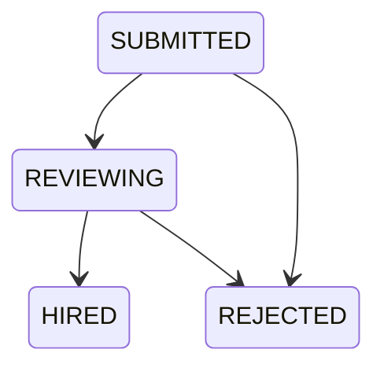

# Hiring workflows and API contract

Updated 2026-10-22. Runtime source of truth: SpringDoc at `/api-docs` and `/swagger-ui.html`. DTOs, controller descriptions, validation, and the integration test cover the contracts below. No dependency versions changed.

## Response and compatibility rules

All application responses use `{success, data, message, timestamp}`. Failures have `success:false`, `data:null`, and a safe message. Expected HTTP errors: 400 malformed/invalid input, 401 unauthenticated or expired credentials, 403 wrong role/ownership, 404 unavailable resource, 409 duplicate/stale/invalid transition.

Existing list endpoints retain array envelopes. New `/page` endpoints return:

```json
{
  "success": true,
  "data": {
    "content": [],
    "totalElements": 0,
    "totalPages": 1,
    "page": 0
  },
  "message": "Applicants loaded",
  "timestamp": "2026-10-22T08:00:00Z"
}
```

Page is zero-based and negative values normalize to zero. New hiring/admin page sizes default to 8 and clamp to 1–50. Existing public jobs still clamp to 1–8. Lists order by timestamp then ID. Empty data stays empty; network failures no longer silently become sample records or successful writes.

| Endpoint | Before | After |
| --- | --- | --- |
| POST /api/auth/refresh-token | Null access token / no usable rotation | New access/refresh pair; single-use database-backed rotation |
| GET /api/jobs and /api/jobs/{id} | Job fields without company/count enrichment; detail could expose drafts | Existing fields plus companyName and applicants; public detail requires ACTIVE |
| GET/PUT /api/employer/profile | Placeholder profile / unpersisted update | Typed company fields read/written in PostgreSQL |
| GET /api/employer/jobs/{id}/applicants | Empty placeholder | Real applicant summary array, first 50; use /page for complete paging |
| GET /api/applications/my | Basic application fields | Same array shape with additive job/company/applicant summaries |
| GET/PUT /api/job-seeker/profile | Untyped response map | Typed response with the existing camelCase profile fields |
| Candidate settings | Browser state only | Persisted contact preferences via dedicated endpoints |
| Job application POST | Could target a non-active job | ACTIVE check, duplicate 409, transactional snapshot and initial event |

Older valid-looking JWTs without the new purpose claim require a fresh sign-in. This is an intentional authentication correction. Old applications have `submission:null` and possibly an empty timeline; the app does not invent historical data.

## Authentication

Access tokens carry purpose=access, issuer, subject, email, role, expiry, and a unique ID. Refresh tokens carry purpose=refresh and are rejected as API bearer tokens. Only SHA-256 token hashes are stored.

- `POST /api/auth/refresh-token`: body `{"refreshToken":"<your refresh token>"}`. The old token is atomically revoked and a new pair is issued in one transaction. Reuse/revocation/expiry/wrong token purpose returns 401.
- `POST /api/auth/logout`: same body; revoke that refresh token. A repeated revocation of a still-valid token is harmless. Invalid/expired tokens return 401.
- Access tokens remain valid until expiry (15 minutes by default); the filter checks banned accounts on every authenticated request.
- Angular coalesces simultaneous refresh requests in a single running app and retries a rejected access token once. It does not attach credentials to external URLs.
- The existing localStorage approach is retained. This change does not provide HttpOnly cookie sessions or cross-tab refresh coordination.
- Demo mode is explicitly false in both checked-in environments. Sample data is never a fallback for failed live requests. The optional sample mode is a limited UI preview, not a complete simulated backend.

## Hiring pipeline

Employer routes require ROLE_EMPLOYER and ownership of the job. A second employer receives 403 even with a valid token.

| Method and path | Request | Response data |
| --- | --- | --- |
| GET /api/employer/stats | — | openJobs, totalJobs, applicants, reviewing, hired |
| GET /api/employer/jobs/{jobId}/applicants/page | page, size, optional status | Page of ApplicationView |
| GET /api/employer/applications/{applicationId} | — | application, submission, timeline |
| PATCH /api/employer/applications/{applicationId}/status | expectedStatus, status, reason | Updated ApplicationView |
| GET /api/applications/my/page | page, size; ROLE_JOB_SEEKER | Page of own applications |
| GET /api/applications/{applicationId} | ROLE_JOB_SEEKER, own application | Snapshot and redacted timeline |

ApplicationView is `{id,jobId,jobSeekerId,status,appliedAt,jobTitle,companyName,applicantName,applicantEmail}`. List queries do not load full profile histories or expose user password hashes, token hashes, or persistence entities. Company/count enrichment uses one batch query per job response list, avoiding a query per card.

Allowed moves:



HIRED and REJECTED are terminal. Every update requires a nonblank reason of at most 2,000 characters:

```json
{
  "expectedStatus": "SUBMITTED",
  "status": "REVIEWING",
  "reason": "Proceed to technical review."
}
```

The conditional database update compares the current status with expectedStatus. A stale update returns 409 and creates no history event. An event records fromStatus, toStatus, timestamp, actor, and internal note. Candidate responses set internalNote and actorUserId to null; employers see the note. The history stays with the application until it is deleted.

An application captures the submitted typed profile JSON and account email in the same transaction as the application and initial event. Subsequent profile edits do not change that snapshot. Résumé and avatar URLs are copied as strings: this is **not file archival**, so externally hosted files or a replaced avatar can change.

## Settings, saving, company details, moderation

ROLE_JOB_SEEKER:

- `GET/PUT /api/job-seeker/settings`: displayName (required, max160), contactEmail (required valid email, max320), discoverable, recommendations. Contact email is a preference and does not change login email or the account email captured on applications. Both flags default false.
- Profile discovery and recommendation delivery are future functionality; the UI explicitly labels these as stored preferences for when available.
- `GET /api/job-seeker/saved-jobs`: ordered UUID array.
- `PUT /api/job-seeker/saved-jobs/{jobId}`: idempotently save an active job.
- `DELETE /api/job-seeker/saved-jobs/{jobId}`: idempotently remove.
- `GET /api/job-seeker/jobs/{jobId}/state`: `{applied,saved}` for the current user.
- `/job-seeker/saved-jobs` lists compact paginated summaries with removal, loading/error/empty states and closed-job indicators. Save/Unsave remains available on job cards/details.
- `GET /api/job-seeker/saved-jobs/page?page=0&size=8`: authenticated candidate only; page is zero-based (negative becomes 0), size clamped to 1..50. Returns `ApiResponse<Page<SavedJob>>`. Fields: `jobId`, `title`, `companyName`, nullable `location`, `status` (ACTIVE/CLOSED/DRAFT), `savedAt`. Sort: savedAt descending, jobId ascending for ties. Closed jobs remain removable. Draft metadata is redacted (title="Job unavailable", companyName="", location=null); deleted jobs disappear through the existing FK cascade. The UUID-list endpoint is unchanged.
- Work experiences in `PUT /api/job-seeker/profile` still replace the complete list. Company/title are required and limited to 180 characters, dates are optional ISO dates, and endDate must not precede startDate when both exist. Invalid input returns 400; an empty list removes all roles. Existing submission snapshots remain immutable.

ROLE_EMPLOYER: company fields are userId, companyName, website, description, location. Company name is required (max180), website must be empty or HTTP(S), description max10000, location max180.

ROLE_ADMIN: `GET /api/admin/users/page` and `GET /api/admin/applications/page` power the admin UI. Legacy array endpoints remain. Users are projected to id/email/role/banned/createdAt. Bans and application deletions persist actor/action/target/reason to audit_logs in the mutation transaction. Existing unban and close-job operations remain as before.

Job validation bounds title/location to schema limits, requires nonnegative salaries, validates currency and salary ordering. Nested profile collections are validated and bounded to 100 entries; résumé URLs allow only HTTP(S). Additional full-profile validation and generated API clients remain future improvements.

## Database change and operation

Flyway V5 is additive and uses PostgreSQL 17-compatible SQL:

- application_snapshots: one immutable submitted profile JSON document per application.
- application_events: one row per accepted stage change.
- job_seeker_settings: one row per user.
- saved_jobs: unique user/job pair.
- Indexes support applicant filtering and ordering, candidate history, employer jobs, refresh-token user lookup, and saved-job access.

The existing unique application constraint prevents duplicate job/user submissions, including concurrent requests. Foreign keys cascade snapshot/event cleanup when applications are removed. The mutation plus event/snapshot uses a single Spring transaction; JPA application inserts are flushed before JDBC captures the snapshot.

Deploy the backend to run V5 through Flyway with ddl-auto=validate. Take a normal database backup first. Do not edit already-applied migrations or drop new tables to roll back an application release: those tables hold user data. Restore an approved backup only if data rollback is explicitly intended. No production or user database was migrated during this implementation; verification used jobsdb_test.

## Search evaluation

Run `backend/scripts/evaluate-search.sql` with psql against an isolated test DB. It creates a temporary 20,000-row dataset and rolls back.

A local PostgreSQL 18.4 run on 2026-10-22 measured 7.234ms for substring counting and 0.163ms for a GIN full-text count, each matching 100 synthetic rows. This is a small synthetic diagnostic, not an application-load benchmark or a PostgreSQL 17 measurement. Full text missed `ang` in `Angular Engineer` and Thai `พัฒนา` in `นักพัฒนาซอฟต์แวร์`, which substring search matched. The public API therefore retains its existing substring semantics. A future search mode can use the existing GIN index after defining partial-word and multilingual behavior.

## Verification

From the repository root (bash):

```bash
(cd backend && ./mvnw test)
(cd frontend && npm ci && npm test -- --watch=false && npm run build)
docker compose --env-file .env.example config --quiet
docker compose --env-file .env.example -f docker-compose.yml -f docker-compose.dev.yml config --quiet
```

Default backend tests skip database integration. To run the complete suite, first create an isolated PostgreSQL 17 database named jobsdb_test, then:

```bash
export JOBSDB_INTEGRATION_TESTS=true
export TEST_DATABASE_URL=jdbc:postgresql://localhost:5432/jobsdb_test
export TEST_DATABASE_USER=jobsdb
export TEST_DATABASE_PASSWORD='<test database password>'
(cd backend && ./mvnw test)
```

The suite rejects database URLs with any other database name before Spring starts Flyway. It writes test records, so use a disposable database and never point it at valuable data. On Windows use backend/mvnw.cmd and npm.cmd.

The GitHub Actions workflow runs the complete backend suite against a postgres:17 service, frontend tests/build, and Compose validation. Its remote run must still be observed after pushing; a workflow file is not a passing CI run.

## Interview scheduling

Interview invitations are independent of application status and use the additive V6 schema. See [Interview scheduling](INTERVIEW_SCHEDULING.md) for endpoints, payloads, ownership, expected-version checks, confirmed-booking conflict handling and calendar downloads. Existing hiring endpoints remain unchanged.
